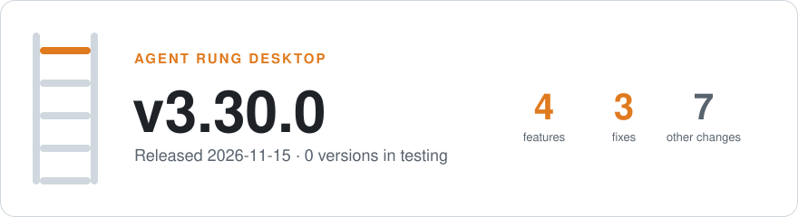

<picture>
  <source media="(prefers-color-scheme: dark)" srcset="assets/whats-new-dark.svg">
  
</picture>

# Agent Rung desktop releases

Installers for the Agent Rung desktop app, and the update feed
\(`latest.json`\) that installed apps read to update themselves\.

## Download v3\.33\.0

Released 2026-11-16\. The app needs an Agent Rung account to do anything\.

| Platform | Installer |
| --- | --- |
| macOS · Apple silicon | [Agent\.Rung\_3\.33\.0\_aarch64\.dmg](https://github.com/panalogy-lab/agent-rung-desktop/releases/download/v3.33.0/Agent.Rung_3.33.0_aarch64.dmg) |
| Windows · installer | [Agent\.Rung\_3\.33\.0\_x64\-setup\.exe](https://github.com/panalogy-lab/agent-rung-desktop/releases/download/v3.33.0/Agent.Rung_3.33.0_x64-setup.exe) |
| Windows · MSI | [Agent\.Rung\_3\.33\.0\_x64\_en\-US\.msi](https://github.com/panalogy-lab/agent-rung-desktop/releases/download/v3.33.0/Agent.Rung_3.33.0_x64_en-US.msi) |

## What's new in v3\.33\.0

### ✨ Features

- **desktop**: name the maker, Panalogy Lab

### 🐛 Fixes

- **landing**: the MCP SDK card names no component

_1 other change \(chores, docs, tests, refactors\)\._

## In testing

Newer builds being tested before one becomes the download above, newest first\.

v3.39.0 · 2026-11-17 · 5 features, 1 fix

#### ✨ Features

- **chat**: one typing line in both shells
- **header**: the web header on the panel sheet
- **chat**: the chat thread and its chrome on the panel sheet
- **shell\_sync**: the ratchet holds \.css pairs too
- **shells**: one panel sheet, the chat screen on the panel ground

#### 🐛 Fixes

- **bridge**: a closed desktop reads as no bridge, not an old release

[Release page and every file](https://github.com/panalogy-lab/agent-rung-desktop/releases/tag/v3.39.0)

v3.38.0 · 2026-11-17 · 8 features, 0 fixes

#### ✨ Features

- **landing**: shells shot shows both shells on one Evidence table
- **shells**: one StatusIndicators, the threads button named alike
- **shells**: one TabbedOutput, Run on the PLCs pill
- **foresight**: a cited controller is read by its whole label
- **eval**: the secrecy eval reads plant names by inflection
- **guard**: a plant name the user's rung says, inflected, is theirs
- **engine**: a cited or proposed rung answers to either name
- **logic**: a controller's logic answers to either of its names

_6 other changes \(chores, docs, tests, refactors\)\._

[Release page and every file](https://github.com/panalogy-lab/agent-rung-desktop/releases/tag/v3.38.0)

v3.37.0 · 2026-11-16 · 3 features, 0 fixes

#### ✨ Features

- **chat**: every outside text renders through Markdown\.svelte
- **markdown**: one inert renderer in both shells
- **csp**: both shells refuse outside script, beacons and hosts

_2 other changes \(chores, docs, tests, refactors\)\._

[Release page and every file](https://github.com/panalogy-lab/agent-rung-desktop/releases/tag/v3.37.0)

v3.36.0 · 2026-11-16 · 5 features, 5 fixes

#### ✨ Features

- **foresight**: a switch\-off says the run stopped in the log
- **landing**: each card shows Rung's own screen
- **landing**: twelve shots of Rung on the press cell
- **shots**: the landing shots are taken as Rung ran
- **shots**: a shot's text is vetted for names it must not show

#### 🐛 Fixes

- **plc**: removing a connected controller ends its session
- **brands**: the upload notes name each controller once
- **plc**: a controller is listed once after its connection is added
- **foresight**: a switch\-off keeps what the run concluded
- **dev**: the engine's parsers run on the venv's Python

_2 other changes \(chores, docs, tests, refactors\)\._

[Release page and every file](https://github.com/panalogy-lab/agent-rung-desktop/releases/tag/v3.36.0)

v3.35.0 · 2026-11-16 · 2 features, 1 fix

#### ✨ Features

- **shells**: a hand\-over names the program of its proposal
- **agent**: a rung locator names the program its routine is in

#### 🐛 Fixes

- **engine**: a cited or proposed rung is found in the program it names

_1 other change \(chores, docs, tests, refactors\)\._

[Release page and every file](https://github.com/panalogy-lab/agent-rung-desktop/releases/tag/v3.35.0)

v3.34.0 · 2026-11-16 · 2 features, 1 fix

#### ✨ Features

- **shells**: bind each sign\-in code to a secret the app makes
- **engine**: sign\-in codes hashed, bound to the asking app, counted

#### 🐛 Fixes

- **web**: start the resend cooldown only after a resend

_2 other changes \(chores, docs, tests, refactors\)\._

[Release page and every file](https://github.com/panalogy-lab/agent-rung-desktop/releases/tag/v3.34.0)

## Earlier versions

v3.32.0 · 2026-11-16 · 3 features, 0 fixes

#### ✨ Features

- **landing**: group what Rung does by its value \(behavior 113\)
- **landing**: design review, ownership and field trials \(behavior 113\)
- **intro**: the slides say what Rung does for a system \(behavior 113\)

_3 other changes \(chores, docs, tests, refactors\)\._

[Release page and every file](https://github.com/panalogy-lab/agent-rung-desktop/releases/tag/v3.32.0)

v3.31.0 · 2026-11-15 · 2 features, 0 fixes

#### ✨ Features

- **intro**: one vendor\-neutral intro, a trial notice \(behavior 111\)
- **tour**: one first\-chat tour for desktop and web \(behavior 111\)

_7 other changes \(chores, docs, tests, refactors\)\._

[Release page and every file](https://github.com/panalogy-lab/agent-rung-desktop/releases/tag/v3.31.0)

v3.30.0 · 2026-11-15 · 4 features, 3 fixes

#### ✨ Features

- **foresight**: the owner tunes foresight from its pane: interval, wakes, kinds, severity
- **knowledge**: the engine log names what an answer cites
- **knowledge**: an answer carries its section's citation as cites
- **prompts**: evidence names the manual a knowledge entry cites

#### 🐛 Fixes

- **deps**: lock pillow 13\.0\.0, past its TIFF IFD advisory
- **eval**: open /ws/user with a ticket, not ?token=
- **engine**: drop the REST approve\-write route and update\_rule/3

_7 other changes \(chores, docs, tests, refactors\)\._

[Release page and every file](https://github.com/panalogy-lab/agent-rung-desktop/releases/tag/v3.30.0)

v3.29.0 · 2026-11-13 · 8 features, 2 fixes

#### ✨ Features

- **sidecar**: read a Siemens CPU's mode from its OperatingMode
- **knowledge**: fill the Siemens map from its five manuals
- **mcp**: say a PLC tool takes the site's label too
- **agents**: name a PLC by alias and the site's label
- **scope**: resolve a PLC name by alias or the site's label
- **knowledge**: refuse an oversized or undecodable map alone
- **knowledge**: write the Siemens map's tables from its driver
- **knowledge**: serve a second brand's map

#### 🐛 Fixes

- **release**: stop the relay on a TERM before its pid is kept
- **release**: read the shipped bundle's version without plutil

_2 other changes \(chores, docs, tests, refactors\)\._

[Release page and every file](https://github.com/panalogy-lab/agent-rung-desktop/releases/tag/v3.29.0)

v3.28.1 · 2026-11-12 · 0 features, 1 fix

#### 🐛 Fixes

- **ladder**: name a Siemens proposal by its network

[Release page and every file](https://github.com/panalogy-lab/agent-rung-desktop/releases/tag/v3.28.1)

v3.28.0 · 2026-11-12 · 3 features, 6 fixes

#### ✨ Features

- **desktop**: say when this computer is not linked to Rung
- **prompts**: ask Siemens sites for LAD networks
- **proposals**: check a Siemens LAD network, refuse its hand\-over

#### 🐛 Fixes

- **eval**: read the model guard's user\-word exception
- **guard**: let a plant word its own rungs say pass the model guard
- **desktop**: open a bridge on every sign\-in after a sign\-out
- **runner**: declare and check function\-tool arguments by type
- **coding**: keep every coding call's outputs in a turn
- **release**: remove the work dir until it stays

[Release page and every file](https://github.com/panalogy-lab/agent-rung-desktop/releases/tag/v3.28.0)

v3.27.0 · 2026-11-11 · 8 features, 5 fixes

#### ✨ Features

- **shells**: take a Siemens block export \.zip
- **shells**: head a LAD citation as network N
- **foresight**: cite a Siemens network by number
- **xref**: class LAD operands as reads or writes
- **cite**: draw a LAD network as a rung
- **logic**: store a Siemens \.zip as simaticml
- **logic**: read Siemens LAD block exports
- **release**: run the shipped sidecar if signed

#### 🐛 Fixes

- **release**: stop the sidecar before its dir goes
- **release**: run copies the seat cannot write
- **engine**: the refusals name the PLC bridge
- **engine**: a refused PLC call names its state
- **deps**: drop pycomm3 and pylogix pins

_4 other changes \(chores, docs, tests, refactors\)\._

[Release page and every file](https://github.com/panalogy-lab/agent-rung-desktop/releases/tag/v3.27.0)

v3.26.0 · 2026-11-11 · 6 features, 1 fix

#### ✨ Features

- send scripts only to a sandboxed sidecar
- **shells**: one code tab per output
- **agent**: coding answers are outputs\[\]
- declare an answer's outputs once
- scripts read and write through rung
- **sidecar**: run scripts in a WASI sandbox

#### 🐛 Fixes

- pending writes answer the caller's own

_6 other changes \(chores, docs, tests, refactors\)\._

[Release page and every file](https://github.com/panalogy-lab/agent-rung-desktop/releases/tag/v3.26.0)

v3.25.0 · 2026-11-11 · 2 features, 0 fixes

#### ✨ Features

- the map's protocol tables are the driver's
- **engine**: seed every brand's knowledge map

_2 other changes \(chores, docs, tests, refactors\)\._

[Release page and every file](https://github.com/panalogy-lab/agent-rung-desktop/releases/tag/v3.25.0)

v3.24.0 · 2026-11-10 · 6 features, 1 fix

#### ✨ Features

- **engine**: read a missed IPv4 PLC directly
- **sidecar**: AB, topology, SmartGuard on cip
- **cip**: identity, backplane and SmartGuard
- **cip**: writes, bit RMW and fragmented writes
- **cip**: Logix list, templates, reads and MSP
- **cip**: encapsulation, CPF and sessions

#### 🐛 Fixes

- **dev**: seat node's distribution on loopback

_4 other changes \(chores, docs, tests, refactors\)\._

[Release page and every file](https://github.com/panalogy-lab/agent-rung-desktop/releases/tag/v3.24.0)

[Every release, with all its files](https://github.com/panalogy-lab/agent-rung-desktop/releases)

## Signed updates

Every update is signed with Agent Rung's key; an installed app refuses
any file that key did not sign\. This repository holds releases only\.
