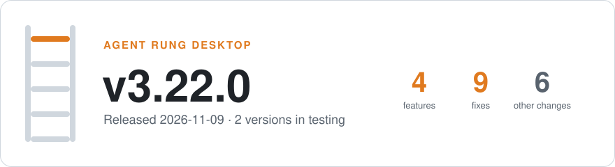

<picture>
  <source media="(prefers-color-scheme: dark)" srcset="assets/whats-new-dark.svg">
  
</picture>

# Agent Rung desktop releases

Installers for the Agent Rung desktop app, and the update feed
\(`latest.json`\) that installed apps read to update themselves\.

## Download v3\.28\.0

Released 2026-11-12\. The app needs an Agent Rung account to do anything\.

| Platform | Installer |
| --- | --- |
| macOS · Apple silicon | [Agent\.Rung\_3\.28\.0\_aarch64\.dmg](https://github.com/panalogy-lab/agent-rung-desktop/releases/download/v3.28.0/Agent.Rung_3.28.0_aarch64.dmg) |
| Windows · installer | [Agent\.Rung\_3\.28\.0\_x64\-setup\.exe](https://github.com/panalogy-lab/agent-rung-desktop/releases/download/v3.28.0/Agent.Rung_3.28.0_x64-setup.exe) |
| Windows · MSI | [Agent\.Rung\_3\.28\.0\_x64\_en\-US\.msi](https://github.com/panalogy-lab/agent-rung-desktop/releases/download/v3.28.0/Agent.Rung_3.28.0_x64_en-US.msi) |

## What's new in v3\.28\.0

### ✨ Features

- **desktop**: say when this computer is not linked to Rung
- **prompts**: ask Siemens sites for LAD networks
- **proposals**: check a Siemens LAD network, refuse its hand\-over

### 🐛 Fixes

- **eval**: read the model guard's user\-word exception
- **guard**: let a plant word its own rungs say pass the model guard
- **desktop**: open a bridge on every sign\-in after a sign\-out
- **runner**: declare and check function\-tool arguments by type
- **coding**: keep every coding call's outputs in a turn
- **release**: remove the work dir until it stays

## In testing

Newer builds being tested before one becomes the download above, newest first\.

v3.28.1 · 2026-11-12 · 0 features, 1 fix

#### 🐛 Fixes

- **ladder**: name a Siemens proposal by its network

[Release page and every file](https://github.com/panalogy-lab/agent-rung-desktop/releases/tag/v3.28.1)

## Earlier versions

v3.27.0 · 2026-11-11 · 8 features, 5 fixes

#### ✨ Features

- **shells**: take a Siemens block export \.zip
- **shells**: head a LAD citation as network N
- **foresight**: cite a Siemens network by number
- **xref**: class LAD operands as reads or writes
- **cite**: draw a LAD network as a rung
- **logic**: store a Siemens \.zip as simaticml
- **logic**: read Siemens LAD block exports
- **release**: run the shipped sidecar if signed

#### 🐛 Fixes

- **release**: stop the sidecar before its dir goes
- **release**: run copies the seat cannot write
- **engine**: the refusals name the PLC bridge
- **engine**: a refused PLC call names its state
- **deps**: drop pycomm3 and pylogix pins

_4 other changes \(chores, docs, tests, refactors\)\._

[Release page and every file](https://github.com/panalogy-lab/agent-rung-desktop/releases/tag/v3.27.0)

v3.26.0 · 2026-11-11 · 6 features, 1 fix

#### ✨ Features

- send scripts only to a sandboxed sidecar
- **shells**: one code tab per output
- **agent**: coding answers are outputs\[\]
- declare an answer's outputs once
- scripts read and write through rung
- **sidecar**: run scripts in a WASI sandbox

#### 🐛 Fixes

- pending writes answer the caller's own

_6 other changes \(chores, docs, tests, refactors\)\._

[Release page and every file](https://github.com/panalogy-lab/agent-rung-desktop/releases/tag/v3.26.0)

v3.25.0 · 2026-11-11 · 2 features, 0 fixes

#### ✨ Features

- the map's protocol tables are the driver's
- **engine**: seed every brand's knowledge map

_2 other changes \(chores, docs, tests, refactors\)\._

[Release page and every file](https://github.com/panalogy-lab/agent-rung-desktop/releases/tag/v3.25.0)

v3.24.0 · 2026-11-10 · 6 features, 1 fix

#### ✨ Features

- **engine**: read a missed IPv4 PLC directly
- **sidecar**: AB, topology, SmartGuard on cip
- **cip**: identity, backplane and SmartGuard
- **cip**: writes, bit RMW and fragmented writes
- **cip**: Logix list, templates, reads and MSP
- **cip**: encapsulation, CPF and sessions

#### 🐛 Fixes

- **dev**: seat node's distribution on loopback

_4 other changes \(chores, docs, tests, refactors\)\._

[Release page and every file](https://github.com/panalogy-lab/agent-rung-desktop/releases/tag/v3.24.0)

v3.23.0 · 2026-11-10 · 2 features, 2 fixes

#### ✨ Features

- **release**: rewrite the releases README in CI
- **release**: the releases README renderer

#### 🐛 Fixes

- **scl**: read any upload in bounded memory
- **release**: a merge that built nothing is none

_9 other changes \(chores, docs, tests, refactors\)\._

[Release page and every file](https://github.com/panalogy-lab/agent-rung-desktop/releases/tag/v3.23.0)

v3.22.0 · 2026-11-09 · 4 features, 9 fixes

#### ✨ Features

- **agent**: trace each iteration's raw usage
- **engine**: the modeler re\-runs on documents
- **rag**: Rung's own Voyage client
- **agent**: a drawing is read once, as text

#### 🐛 Fixes

- **foresight**: take an SCL block's line as cited
- **modeler**: search the documents per machine
- **modeler**: propose as it goes and at its end
- **modeler**: hold a pass's key while docs ingest
- **agent**: transcripts meter what they bill
- **engine**: cross\_reference reads SCL assignments
- **agent**: every billed token is metered
- **engine**: a long ingest runs, a wedged one ends
- **agent**: each controller in its brand's terms

_6 other changes \(chores, docs, tests, refactors\)\._

[Release page and every file](https://github.com/panalogy-lab/agent-rung-desktop/releases/tag/v3.22.0)

v3.21.0 · 2026-11-09 · 2 features, 6 fixes

#### ✨ Features

- **logic**: upload and cite Siemens SCL
- **logic**: SCL sources parsed into routines

#### 🐛 Fixes

- **modeler**: bound a run's input in tokens
- **engine**: a slice pass survives model growth
- **engine**: the guard counts no fixed state name
- **engine**: the modeler works a model in slices
- **engine**: read the site model within a budget
- **logic**: "an Allen\-Bradley" in the refusal

_1 other change \(chores, docs, tests, refactors\)\._

[Release page and every file](https://github.com/panalogy-lab/agent-rung-desktop/releases/tag/v3.21.0)

v3.20.0 · 2026-11-09 · 6 features, 9 fixes

#### ✨ Features

- **dev**: relay can run the built sidecar
- **engine**: scan reads endpoints over the link
- **sidecar**: read a controller's mode by alias
- **dev**: a browser relay to the sidecar
- **desktop**: add a Siemens controller
- **desktop**: an OPC UA driver for Siemens

#### 🐛 Fixes

- **dev**: relay finds a relative sidecar binary
- **dev**: relay answers engine scans with none
- **engine**: the bridge poll keeps each brand
- **agent**: a dwell claims what its reads show
- **engine**: get\_rung reads a routine's program
- **agent**: a deadlock the logic leaves is logic
- **engine**: output\_on names the state's reads
- **engine**: guard a finding as it is kept
- **engine**: judge departures as a PLC is read

_3 other changes \(chores, docs, tests, refactors\)\._

[Release page and every file](https://github.com/panalogy-lab/agent-rung-desktop/releases/tag/v3.20.0)

v3.19.0 · 2026-11-08 · 7 features, 3 fixes

#### ✨ Features

- **foresight**: optimization findings from slack
- **foresight**: step times, slack and gain
- **foresight**: a bounded timing capture
- **desktop**: plc\.capture\_tags, clamped here too
- **desktop**: browse and read with our client
- **desktop**: own OPC UA secure channel, session
- **engine**: sign and check tokens ourselves

#### 🐛 Fixes

- **foresight**: only the first capture is new
- **foresight**: a stay near the preset is timed
- **foresight**: a changed preset is a new finding

_6 other changes \(chores, docs, tests, refactors\)\._

[Release page and every file](https://github.com/panalogy-lab/agent-rung-desktop/releases/tag/v3.19.0)

v3.18.0 · 2026-11-08 · 3 features, 0 fixes

#### ✨ Features

- **web**: no login token in a URL
- **desktop**: no login token in a URL
- **engine**: one\-use tickets; query tokens narrowed

[Release page and every file](https://github.com/panalogy-lab/agent-rung-desktop/releases/tag/v3.18.0)

[Every release, with all its files](https://github.com/panalogy-lab/agent-rung-desktop/releases)

## Signed updates

Every update is signed with Agent Rung's key; an installed app refuses
any file that key did not sign\. This repository holds releases only\.
